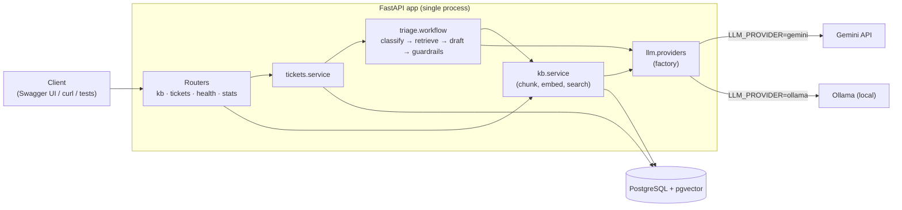

# TriageDesk

AI-assisted support-ticket triage — a REST API plus a web UI for the review team. Each new ticket is **classified** (category, priority,
sentiment) with LLM structured output, matched against a **knowledge base** with pgvector
search, and given a **draft reply grounded in the retrieved articles**. Deterministic Python
guardrails then decide whether a human must review it. Nothing is ever sent automatically.

Stack: Python 3.12 · FastAPI · PostgreSQL 17 + pgvector · SQLAlchemy 2 · Alembic ·
LangChain (core) · **Gemini or Ollama**, switchable by config · plain HTML/CSS/JS UI.
Design docs: [requirements.md](requirements.md) · [architecture.md](architecture.md) ·
[implement_1.md](implement_1.md).

## Architecture



The triage pipeline is a fixed sequence, not an agent:

1. **Classify** — `CLASSIFY_PROMPT | model.with_structured_output(Classification)`, temperature 0.
2. **Retrieve** — embed `subject + body`, top-k by cosine distance, keep `distance ≤ RETRIEVAL_MAX_DISTANCE`.
3. **Draft** — only if something was retrieved; the model may cite only the given article ids.
4. **Guardrails** — plain Python: urgent priority, negative + high, low confidence, unknown
   citation, empty reply or no KB match → `needs_review`; otherwise `auto_ready`.

Any LLM failure degrades to `needs_review` (the API never returns 500 for it), and every run is
stored in `triage_runs` with provider, model, prompt version, per-step timings and error.

## Quickstart (local)

Prerequisites: Python 3.12, [uv](https://docs.astral.sh/uv/), Docker, and either Ollama or a
Gemini API key.

```bash
cp .env.example .env                 # set LLM_PROVIDER, and GOOGLE_API_KEY for Gemini
uv sync --extra dev
docker compose up -d db              # Postgres + pgvector on localhost:5434
uv run alembic upgrade head
uv run python scripts/seed_kb.py     # 10 sample help articles (safe to re-run)
uv run fastapi dev app/main.py       # UI: http://localhost:8000  ·  API docs: /docs
```

For Ollama: `ollama pull hermes3:8b` and `ollama pull nomic-embed-text` (768-d embeddings).

> **Windows note:** the DB is published on host port **5434** because a native Windows
> PostgreSQL service commonly occupies 5432.

Try it:

```bash
curl -X POST localhost:8000/api/v1/tickets -H "Content-Type: application/json" \
  -d '{"customer_email":"sam@example.com","subject":"Charged twice this month","body":"My card was charged twice for the Pro plan. Please refund one."}'
curl localhost:8000/api/v1/tickets?status=needs_review
curl -X POST localhost:8000/api/v1/tickets/1/review -H "Content-Type: application/json" \
  -d '{"action":"edit","final_reply":"We have refunded the duplicate charge."}'
```

## Quickstart (Docker)

```bash
cp .env.example .env
docker compose up --build            # db + api; api runs migrations, then serves on :8000
uv run python scripts/seed_kb.py     # seed from the host (DB is on localhost:5434)
```

Ollama stays on the host; the container reaches it via `host.docker.internal`.

## Web UI

Open **http://localhost:8000**. The UI is static HTML/CSS/ES-module JavaScript in
[app/static/](app/static/), served by the same FastAPI process — no Node toolchain, no build
step, no second service, and same-origin requests so no CORS setup.

| Page | What it does |
|------|--------------|
| **Tickets** | Review queue with status tabs (live counts) and a category filter, newest first. |
| **Ticket** | Customer message · classification · *why* it was routed to review · editable draft with its cited sources · approve / approve-with-edits / reject (with note) · re-run triage · full run history with per-step timings and errors. |
| **New ticket** | Submit a ticket and wait for synchronous triage; three sample tickets for demos. |
| **Knowledge base** | Search playground showing the exact distances triage sees · add / delete articles · re-index. |
| **Insights** | Tickets by status and category, review load, average triage time per provider. |

Customer text is untrusted input, so the UI never uses `innerHTML`: everything is rendered as
text nodes through a small `h()` helper ([app/static/js/dom.js](app/static/js/dom.js)), and a
unit test fails the build if an HTML sink appears.

## Switching providers

Set `LLM_PROVIDER=gemini` or `ollama` in `.env` and restart — no code changes. Only
[app/llm/providers.py](app/llm/providers.py) knows which provider is in use.

Switching the **embedding** model also needs `POST /api/v1/kb/reindex`: vectors from different
models aren't comparable, so search only uses chunks tagged with the current model.

## Tests

```bash
uv run pytest -q
```

- **Unit tests** (guardrails, workflow, chunking, schemas) use `RunnableLambda` fakes — no
  network, no API keys, no DB.
- **UI tests** check that `/` serves the app without shadowing `/api`, `/docs` or
  `/openapi.json`, that every ES-module import resolves, and that no HTML sinks are used.
- **Integration tests** hit a real `triagedesk_test` database (created and migrated
  automatically) with fake LLM + embeddings; each test is rolled back. They are skipped when
  Postgres isn't reachable.

## Evaluation

`uv run python scripts/eval_triage.py` classifies the 24 labelled tickets in
[data/eval_tickets.jsonl](data/eval_tickets.jsonl) with the active provider and prints accuracy
per field, every mistake, and latency. The priority rubric behind the labels is in the script's
docstring.

| provider | model | prompt | category acc | priority acc | median latency |
|----------|-------|--------|--------------|--------------|----------------|
| ollama | hermes3:8b | v1 (current classify prompt) | 92% | 67% | 5.5 s |
| ollama | hermes3:8b | v2 (rejected) | 92% | 62% | 6.0 s |

Measured 2026-10-03 on a local machine (Ollama latency depends on hardware). Gemini not yet
measured — add a `GOOGLE_API_KEY` and run the script with `LLM_PROVIDER=gemini`.

What the numbers say:

- **Category is solid; priority is the weak field.** With v1, 5 of 8 priority mistakes are
  over-escalation (medium → high, e.g. a duplicate charge or a forgotten password), and an
  account takeover was rated `high` instead of `urgent`.
- **v2 (category definitions + a four-level priority rubric in the prompt) did not help**:
  priority dropped to 62% and different tickets failed. A longer prompt isn't automatically a
  better one for an 8B model, so v1 stays. Next candidates: few-shot examples, or Gemini.
- **Guardrails absorb the bias.** Over-escalating is the safe direction — `urgent` and
  `negative + high` tickets go to human review anyway.
- **Prompt v1.1 / v1.2 only change the draft prompt** (state the 0–1 confidence range; say
  that `reply` is the customer-facing message). Both fixed real failures seen in end-to-end
  runs; classification wording is unchanged, so the v1 rows above still apply. The eval covers
  classification only — drafting quality is checked by hand and by the guardrails.
- With 24 tickets one ticket is ~4 points, and repeated runs at temperature 0 still vary
  slightly on Ollama, so treat small differences as noise. Tuning prompts on the same set you
  report on overfits; grow the set (or keep a held-out part) before trusting small gains.

## Design decisions

1. **Explicit pipeline, not an agent.** The steps never change order; an `if` handles the one
   branch (skip drafting when nothing relevant was retrieved).
2. **Structured output everywhere the LLM speaks.** Validated Pydantic objects, no regex parsing.
3. **LLM proposes, code decides.** Review routing is plain, unit-tested Python, not a prompt.
4. **Fail safe.** LLM errors are recorded and the ticket goes to a human.
5. **Synchronous triage.** `POST /tickets` waits for the result; the ticket is committed as
   `pending` first, so a crash mid-triage leaves it re-runnable.
6. **Sync SQLAlchemy + `def` endpoints.** FastAPI runs them in a threadpool.
7. **One 768-d vector column for both providers**, tagged with `embedding_model`.
8. **The UI is static files in the same process.** It adds a screen, not a service — hash
   routing, no framework, no build — so the single-process architecture still holds.

## What's next

Background triage (`BackgroundTasks`) if latency hurts · LangGraph only if steps need tool calls
or retries · API-key auth before anything is public · hybrid (full-text + vector) search for
product codes.
